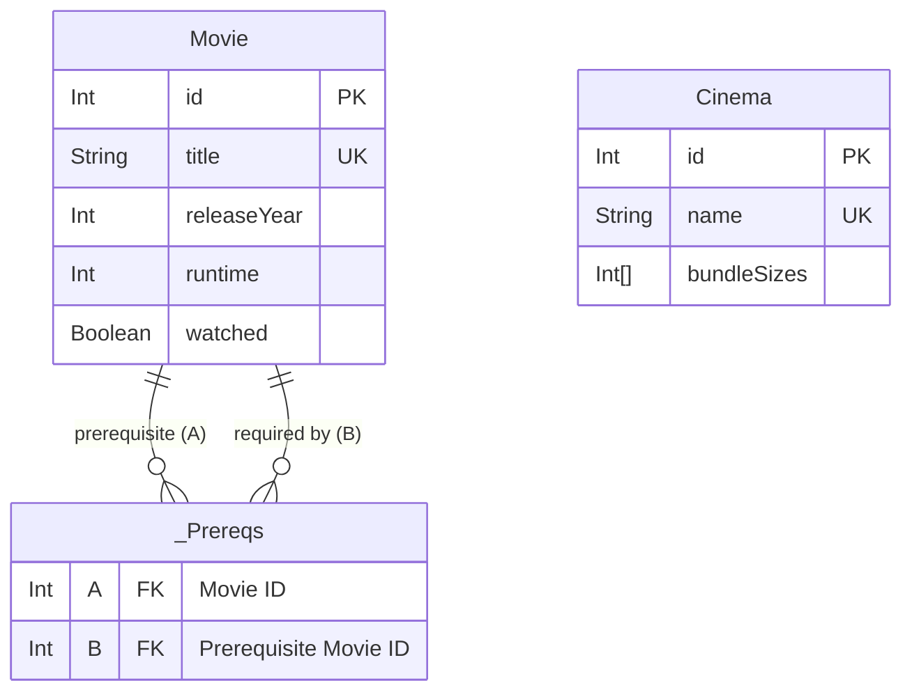

# Doomsday Ready

MCU Rewatch Planner & Ticket Booking Engine — built for the Blinto Full Stack Developer assessment. The application allows Marvel Cinematic Universe fans to plan their rewatch marathon in storyline dependency order before *Avengers: Doomsday* and optimize opening-night watch party ticket purchases using pure algorithms.

### Features
- **Storyline Dependency Management**: View, add, and update MCU movies and their prerequisites.
- **Cycle Prevention**: DFS cycle detection rejects self-dependencies and indirect circular prerequisite chains with HTTP 409 `CIRCULAR_DEPENDENCY`.
- **Topological Rewatch Order**: Generates a valid rewatch timeline using post-order DFS, tracking watched progress and remaining runtime.
- **Dynamic Ticket Bundle Optimization**: Exact-sum ticket allocation using bottom-up dynamic programming to find the fewest bundles for watch party groups.
- **Cinematic dark-themed UI**: Responsive React frontend featuring theatrical poster cards, interactive watched toggles, and dedicated views for movies, rewatch timelines, and cinema booking.

---

## Tech Stack

- **Backend**: Node.js, Express 5, TypeScript (strict mode)
- **Database**: PostgreSQL (hosted on Neon Cloud), Prisma ORM 6.19
- **Validation & Errors**: Zod, custom `AppError` central error handler
- **Testing**: Vitest, Supertest (74 tests across 7 test suites)
- **Frontend**: React 19, TypeScript, Vite 8, Tailwind CSS 4
- **Architecture**: Monorepo (`/backend`, `/frontend`), zero Docker

---

## Project Structure

```
doomsday-ready/
├── backend/
│   ├── prisma/
│   │   ├── migrations/          # SQL migration files
│   │   ├── schema.prisma        # Prisma models (Movie, Cinema)
│   │   └── seed.ts              # MCU seed data (8 movies, 4 cinemas)
│   ├── src/
│   │   ├── algorithms/          # Pure algorithm implementations
│   │   │   ├── findMinBundles.ts
│   │   │   ├── getRewatchOrder.ts
│   │   │   └── wouldCreateCycle.ts
│   │   ├── controllers/         # Request handling & input validation
│   │   │   ├── cinema.controller.ts
│   │   │   └── movie.controller.ts
│   │   ├── errors/              # AppError custom error class
│   │   │   └── AppError.ts
│   │   ├── lib/                 # Prisma singleton client
│   │   │   └── prisma.ts
│   │   ├── middleware/          # Central error handling middleware
│   │   │   └── errorHandler.ts
│   │   ├── routes/              # Express routes mounted under /api
│   │   │   ├── cinema.routes.ts
│   │   │   ├── index.ts
│   │   │   └── movie.routes.ts
│   │   ├── schemas/             # Zod input validation schemas
│   │   │   ├── cinema.schema.ts
│   │   │   └── movie.schema.ts
│   │   ├── services/            # Business logic & database operations
│   │   │   ├── cinema.service.ts
│   │   │   └── movie.service.ts
│   │   ├── app.ts               # Express application setup
│   │   └── server.ts            # Server entry point (port 3000)
│   └── tests/                   # Vitest unit & integration test suites
│       ├── cinemas.test.ts
│       ├── findMinBundles.test.ts
│       ├── getRewatchOrder.test.ts
│       ├── health.test.ts
│       ├── movies.test.ts
│       ├── rewatchOrder.test.ts
│       └── wouldCreateCycle.test.ts
├── frontend/
│   ├── public/
│   │   └── posters/             # Local theatrical movie posters (<300 KB each)
│   └── src/
│       ├── assets/              # SVG logos & icons
│       ├── components/          # React components (Header, MoviesView, RewatchPlanView, BookingView, Modal, MoviePoster)
│       ├── utils/               # Slugifier & formatting utilities
│       ├── api.ts               # Type-safe API client
│       ├── App.tsx              # Main layout & tab orchestration
│       ├── main.tsx             # React entry point
│       └── types.ts             # TypeScript domain interfaces
├── AI_USAGE.md                  # Honest disclosure of AI usage & development log
├── PROJECT_CONTEXT.md           # Assessment specifications & constraints
└── README.md                    # Project documentation
```

---

## Getting Started (No Docker)

### Prerequisites
- **Node.js**: Version 22 or higher
- **PostgreSQL**: A free [Neon](https://neon.tech) serverless cloud PostgreSQL database (or any PostgreSQL instance)

### Backend Setup

1. **Clone the repository**:
   ```bash
   git clone https://github.com/ah-nd-naf/doomsday-ready
   cd doomsday-ready/backend
   ```

2. **Install dependencies**:
   ```bash
   npm install
   ```

3. **Configure environment variables**:
   Copy `.env.example` to `.env`:
   ```bash
   cp .env.example .env
   ```
   *(On Windows Command Prompt / PowerShell, use `copy .env.example .env`).*

   Edit `.env` and set your `DATABASE_URL` with a direct connection string including `?sslmode=require` (migrations require the direct, non-pooled connection URL):
   ```env
   DATABASE_URL="postgresql://<user>:<password>@<host>.neon.tech/neondb?sslmode=require"
   PORT=3000
   ```

4. **Run migrations**:
   Apply the existing Prisma migration to create the database schema:
   ```bash
   npx prisma migrate deploy
   ```
   *(Note: `npx prisma migrate dev` also works on a development database).*

5. **Seed the database**:
   Populate the database with the assessment's initial MCU movies and cinemas:
   ```bash
   npx prisma db seed
   ```

6. **Start the backend development server**:
   ```bash
   npm run dev
   ```
   The backend server starts on `http://localhost:3000`.

### Frontend Setup

In a new terminal window:

1. **Navigate to the frontend directory**:
   ```bash
   cd ../frontend
   ```

2. **Install dependencies**:
   ```bash
   npm install
   ```

3. **Start the frontend development server**:
   ```bash
   npm run dev
   ```
   Vite starts the frontend on `http://localhost:5173`. Open the URL in your browser.

> [!NOTE]
> The Vite development server is configured with a proxy (`vite.config.ts`) that forwards all `/api` calls to `http://localhost:3000`. No CORS package is needed on the backend.

---

## Running Tests

All unit and integration tests are run using Vitest in the backend:

```bash
cd backend
npm test
```

### Verified Test Output
```
 Test Files  7 passed (7)
      Tests  74 passed (74)
   Start at  13:11:34
   Duration  8.51s (tests 90%, import 9%, transform 1%, worker 1%)
```

Test coverage includes:
- Pure algorithm unit tests: cycle detection (8 tests), rewatch order DFS (6 tests), dynamic programming bundle allocation (9 tests).
- API & integration tests: health endpoint (1 test), movies CRUD & validation (20 tests), cycle rejection & rewatch order calculations (8 tests), cinema CRUD & booking calculations (22 tests).

---

## API Reference

All application endpoints are served under `/api`.

| Method | Endpoint | Purpose | Request Body | Response (Success) |
| :--- | :--- | :--- | :--- | :--- |
| `GET` | `/api/health` | Service health probe | None | `200`: `{ "status": "ok" }` |
| `GET` | `/api/movies` | List all movies with prerequisites | None | `200`: `[ { "id": 1, "title": "Iron Man", "releaseYear": 2008, "runtime": 126, "watched": false, "prerequisites": [] }, ... ]` |
| `POST` | `/api/movies` | Create movie(s) (object or array) | `{ "title": "Avengers: Secret Wars", "releaseYear": 2027, "runtime": 180, "prerequisiteIds": [8], "watched": false }` | `201`: `{ "id": 9, "title": "Avengers: Secret Wars", "releaseYear": 2027, "runtime": 180, "watched": false, "prerequisites": [{ "id": 8, "title": "Avengers: Doomsday" }] }` |
| `PATCH` | `/api/movies/:id` | Update movie (watched status / prerequisites) | `{ "watched": true, "prerequisiteIds": [1, 2] }` | `200`: `{ "id": 3, "title": "The Avengers", "releaseYear": 2012, "runtime": 143, "watched": true, "prerequisites": [{ "id": 1, "title": "Iron Man" }, { "id": 2, "title": "Captain America: The First Avenger" }] }` |
| `GET` | `/api/movies/:id/rewatch-order` | Topological rewatch plan & runtime stats | None | `200`: `{ "target": { "id": 8, "title": "Avengers: Doomsday" }, "order": [ ... ], "summary": { "total": 7, "watched": 0, "unwatched": 7, "remainingRuntimeMinutes": 1000 } }` |
| `GET` | `/api/cinemas` | List all cinemas with bundle sizes | None | `200`: `[ { "id": 1, "name": "Test Cinema A", "bundleSizes": [1, 3, 4] }, ... ]` |
| `POST` | `/api/cinemas` | Create cinema(s) (object or array) | `{ "name": "Cineplex Premier", "bundleSizes": [2, 4, 8] }` | `201`: `{ "id": 4, "name": "Cineplex Premier", "bundleSizes": [2, 4, 8] }` |
| `GET` | `/api/cinemas/:id/booking?groupSize=6` | Calculate fewest bundles for exact group size | None (query param `groupSize`) | `200`: `{ "cinema": { "id": 1, "name": "Test Cinema A" }, "groupSize": 6, "possible": true, "totalBundles": 2, "bundles": [{ "size": 3, "count": 2 }] }` |

### Error Response Shape
All errors return a standardized JSON structure:
```json
{
  "error": {
    "code": "VALIDATION_ERROR",
    "message": "Validation failed",
    "details": [
      { "path": ["runtime"], "message": "runtime must be between 1 and 300 minutes" }
    ]
  }
}
```

### Standard Error Codes
- `VALIDATION_ERROR` (HTTP 400): Malformed JSON, missing/invalid query parameter, or schema validation failure.
- `NOT_FOUND` (HTTP 404): Target movie, cinema, prerequisite ID, or unknown route not found.
- `DUPLICATE` (HTTP 409): Unique constraint violation on movie title or cinema name (Prisma P2002 mapping).
- `CIRCULAR_DEPENDENCY` (HTTP 409): Setting prerequisites would cause a circular dependency.
- `INTERNAL_ERROR` (HTTP 500): Unhandled server exceptions.

---

## Algorithms

All algorithmic logic consists of hand-written pure functions in `backend/src/algorithms/` with zero third-party graph or optimization libraries.

### 1. Cycle Detection (`backend/src/algorithms/wouldCreateCycle.ts`)
- **Approach**: Iterative Depth-First Search (DFS) using an explicit stack and a `visited` Set. If candidate prerequisites contain `movieId` directly, or if traversing prerequisite edges from any candidate prerequisite reaches `movieId`, a cycle is detected.
- **Time Complexity**: $O(V + E)$, where $V$ is the number of movies and $E$ is the number of prerequisite dependency edges.
- **Space Complexity**: $O(V)$ for the stack and visited set.

### 2. Rewatch Order (`backend/src/algorithms/getRewatchOrder.ts`)
- **Approach**: Post-order recursive Depth-First Search (DFS) starting from the target movie's prerequisites. A movie is appended to the order list only after all of its prerequisites have been visited. A `visited` Set ensures every prerequisite appears exactly once, and the target movie itself is excluded.
- **Time Complexity**: $O(V + E)$ to traverse the dependency subgraph.
- **Space Complexity**: $O(V)$ for recursion stack and output list.
- **Note**: Assumes an acyclic graph (DAG) because cycle creation is rejected on write.

### 3. Ticket Bundle Allocation (`backend/src/algorithms/findMinBundles.ts`)
- **Approach**: Bottom-up 1D Dynamic Programming over values $0 \dots \text{groupSize}$. `dp[n]` tracks the minimum bundle count to form exact sum $n$, while `lastUsed[n]` records the bundle size selected to achieve that minimum. Available sizes are sorted ascending, and updates only occur on strictly smaller bundle counts, ensuring deterministic tie-breaking. Reconstructing the solution aggregates bundles and returns larger bundle sizes first.
- **Time Complexity**: $O(\text{groupSize} \times B)$, where $B$ is the number of available bundle sizes (at most 10).
- **Space Complexity**: $O(\text{groupSize})$ for `dp` and `lastUsed` lookup tables.
- **Why Greedy Fails**: For bundle sizes `[1, 3, 4]` and group size `6`, a greedy strategy selects 4 first, leaving 2, which requires two 1-size bundles ($4 + 1 + 1 = 3$ bundles). The DP algorithm finds the global optimum of two 3-size bundles ($3 + 3 = 2$ bundles).

---

## Data Model



---

## Assumptions and Design Decisions

- **Release Year Range**: `releaseYear` accepts integers between 1900 and 2100 (the assessment brief specified no range).
- **Batch Endpoint Transactions**: `POST /movies` and `POST /cinemas` accept either a single object or an array. Arrays execute in order inside a single database transaction (`$transaction`); if any item fails, all items are rolled back.
- **Prerequisite Validation**: `prerequisiteIds` in `POST /movies` must reference movies that already exist in the database (forward references to other items in the same batch are rejected).
- **Prerequisite Updates**: `PATCH /movies/:id` replaces the full prerequisite set with the provided array.
- **Strict Input Validation**: Unknown fields on request payloads are rejected via Zod `.strict()`.
- **Error Mapping**: Referencing an unknown prerequisite ID returns HTTP 404 `NOT_FOUND`. Duplicate titles or cinema names return HTTP 409 `DUPLICATE`.
- **Self-Dependency**: Setting a movie to depend on itself is treated as a circular dependency and returns HTTP 409 `CIRCULAR_DEPENDENCY`.
- **Cinema Bundle Sizes**: `bundleSizes` must contain 1–10 distinct positive integers between 1 and 500 (duplicate values are rejected).
- **Booking Group Size**: `groupSize` is required as a query parameter (integer 1–10,000) for booking quotes.
- **Impossible Bookings**: When a group size cannot be formed with available bundles, the API returns HTTP 200 with `{ "possible": false, "message": "..." }`.
- **Deterministic Tie-Breaking**: If several combinations use the same number of bundles, the first one found is returned: sizes are tried in ascending order and only a strictly smaller count replaces the current best. The response lists larger sizes first.
- **Concurrency & Cycle Check**: In `PATCH /movies/:id`, the cycle check and the subsequent database update are separate steps rather than a serialized table lock. Two simultaneous requests could theoretically form a cycle; this is an accepted tradeoff at this scale.
- **Approximate Seed Data**: Seed runtimes and release years are approximate sample data, not an official watch guide.
- **Prisma Version**: Prisma `6.19.3` is used because Prisma 7 introduced configuration and peer dependency issues during setup.
- **CORS & Proxy**: Frontend uses a Vite dev proxy (`/api` $\to$ `http://localhost:3000`) instead of enabling the CORS package on the Express backend.

---

## What I Did Not Include

- **Docker Compose (Bonus)**: Not included due to local disk space constraints and the inability to reliably test Docker containers locally. Untested infrastructure files were intentionally not shipped.

---

## Artwork Credit

Movie posters belong to Marvel Studios / Disney and are used for demonstration only.

---

## How I used AI

I used AI tools openly in this project. Here is exactly how.

**Claude (chat), used as a mentor, not as a code writer for the core logic:**
- Helped me understand the assessment and choose the stack (Node, Express, TypeScript, PostgreSQL, Prisma).
- Explained the ideas behind the three algorithms in plain language and broke them into small steps: DFS for cycle detection, DFS post-order for the rewatch order, and bottom-up dynamic programming for the booking quote (and why greedy fails for sizes 1, 3, 4 with group size 6).
- Reviewed the code I wrote, pointed out edge cases.
- Gave me a step-by-step plain-language outline of each algorithm; I wrote the code from those outlines.
- Drafted PROJECT_CONTEXT.md and the prompts I gave to the coding agent.

**What I wrote myself:** the logic of Feature 1 and Feature 2, i.e. the three pure functions in `backend/src/algorithms/` (`wouldCreateCycle`, `getRewatchOrder`, `findMinBundles`). No library is used for them.

**Antigravity (AI coding agent), used for the rest, from prompts drafted with Claude's help and checked by me:**
- Project scaffolding, Prisma schema, migration and seed data
- Express routes, controllers, services, Zod validation and error handling
- The Vitest/Supertest tests, including the unit tests for my three algorithms (the agent was told not to modify my algorithm files)
- The whole React frontend, including the visual design and poster handling
- Parts of this README

I read and tested the generated code and can explain it. The agent was instructed (see `PROJECT_CONTEXT.md`) never to implement the three algorithms.

---

## Live Demo

Live demo: (to be added)
